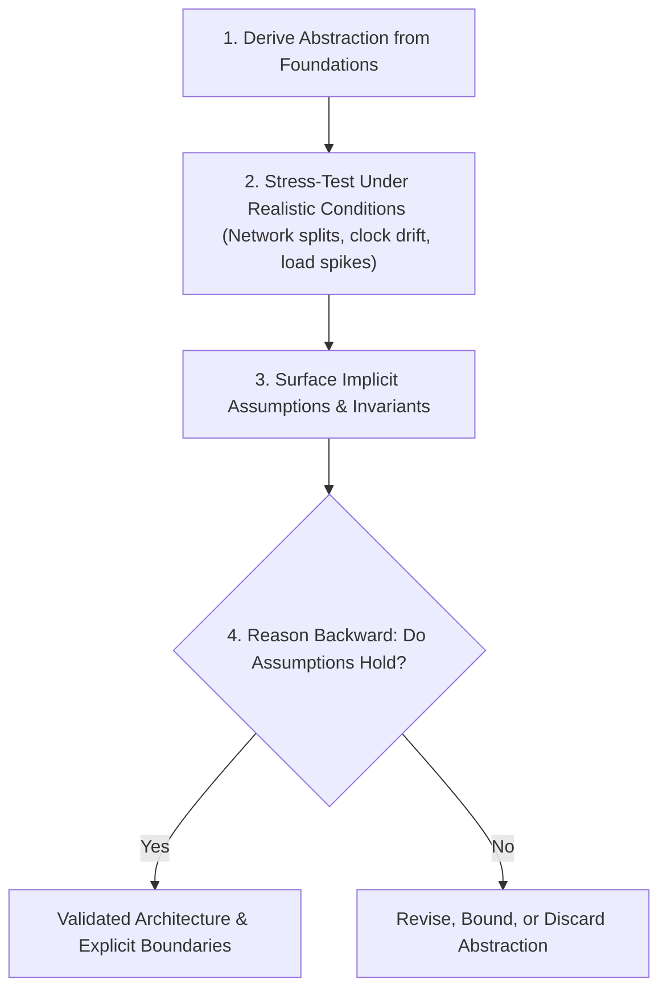

# Technical Reasoning & Scientific Method

## I. Governing Philosophy: First Principles

The author reasons from first principles rather than industry convention, authority, or prevailing trends. Every architectural assertion must be derived from underlying physical, computational, or mathematical realities.

### Forward Scientific Trajectory
When constructing an explanation from the ground up:
$$\text{Observation} \longrightarrow \text{Deduction} \longrightarrow \text{Principle} \longrightarrow \text{Implication}$$

In complex systems and software engineering, this trajectory expands into:
$$\text{Foundations} \longrightarrow \text{Mechanisms} \longrightarrow \text{Abstractions} \longrightarrow \text{Composition} \longrightarrow \text{Implementation} \longrightarrow \text{Operations} \longrightarrow \text{Organizational Consequences}$$

*Note:* These trajectories represent preferred cognitive reasoning sequences, **not mandatory article headings or rigid outline templates**.

### Argumentative Progression & Relational Transitions
Arguments must develop through intelligible logical relationships rather than arbitrary lists of points or superficial topical transitions. Ensure clear causality across key conceptual boundaries:

- **From Observation to Governing Principle**: Establish empirical facts or operational failure modes before inducing the underlying systemic law.
- **From Engineering Constraint to Architectural Decision**: Ground structural choices in explicit limitations (latency budgets, failure domains, consistency models) rather than convention.
- **From Mechanism to Resulting Properties**: Demonstrate how components causally interact to produce system properties (e.g., how fencing tokens guarantee linearizability, not merely asserting that the system is safe).
- **From Technical Limitation to Design Trade-off**: Acknowledge what the architecture sacrifices, framing trade-offs as calculated economic or physical balances rather than flaws.
- **From Conceptual Proposition to Practical Implementation**: Anchor high-level abstractions in concrete runtime constructs (code, data structures, state machines, protocol contracts).

> **Flexibility Principle:** These relationships represent logical connections, not a rigid sequential template. The goal is unbroken continuity of thought without formulaic, repetitive paragraph structures.

---

## II. Bidirectional Reverse Reasoning (Core Method)

True architectural rigor requires testing forward derivations through reverse validation. An abstraction is only valid if its assumptions hold under adverse conditions.

### The 5-Step Bidirectional Cycle:
1. **Derive the Abstraction**: Formulate the architectural abstraction or pattern from foundational constraints and requirements.
2. **Examine Under Adverse Conditions**: Subject the abstraction to realistic operating environments (e.g., partial network partitions, disk stalls, process pauses, uncoordinated writes).
3. **Isolate Assumptions & Invariants**: Enumerate exactly what must remain true for the system to guarantee correctness (e.g., monotonic clocks, fencing tokens, linearizable registers).
4. **Reason Backward**: Trace backward from boundary failures to determine whether foundational assumptions were violated or over-extended.
5. **Revise the Abstraction**: Modify the pattern, tighten its applicability bounds, or reject it entirely where assumptions do not hold in production.

---

## III. The 11 Dimensions of Technical Reasoning

When explaining, evaluating, or designing a technical system, assess which of the following 11 dimensions are necessary to advance the thesis:

1. **The Core Problem**: The underlying tension, bottleneck, or physical constraint that demands a solution.
2. **Rigorous Definitions**: Precise distinction between closely adjacent concepts (e.g., *durability* vs. *availability*, *safety* vs. *liveness*).
3. **Fundamental Principles & Assumptions**: Explicit axioms governing the environment (network model, failure domain, storage semantics).
4. **Causal Mechanisms**: The actual sequence of operations that produces the observed behavior.
5. **Component Relationships**: Inter-component boundaries, dependencies, protocols, and data contracts.
6. **Correctness Conditions & System Invariants**: Uncompromising state invariants (e.g., zero overselling, exactly-once external side-effects, total ordering).
7. **Practical Implementation**: Code, pseudocode, schema definitions, or configuration primitives.
8. **Failure Scenarios & Counterexamples**: Concrete counterexamples exposing edge cases, race conditions, or stale-state traps.
9. **Architectural Trade-offs**: Explicit examination of what is sacrificed (latency vs. consistency, memory overhead vs. CPU cycles, simplicity vs. flexibility).
10. **Operational Implications**: Real-world operational considerations including observability, telemetry, capacity limits, failure recovery, security, cost, and organizational boundaries.
11. **Transferable Decision Criteria**: A concrete heuristic, decision tree, or criterion enabling an engineer to choose between competing alternatives.

*Rule:* Never treat this list as an article checklist. Deploy only the dimensions that materially substantiate the specific technical argument.

---

## IV. Pragmatic Implementation Focus

The author's primary technical domain spans:
- Software engineering & clean systems architecture
- Distributed systems, consensus, and replication
- Concurrency, multi-threading, and memory models
- Enterprise Java, Spring ecosystem, and modern backend runtimes
- Algorithms, data structures, and state management
- Cloud platforms, container runtimes, and resilient infrastructure

### Anti-Cargo-Cult Rule
- **Never assume that naming a pattern explains its behavior.** Merely labeling an architecture as "Hexagonal", "Event-Driven", or "Unit of Work" provides zero explanatory value without demonstrating the causal interaction of its parts.
- Progress from foundational understanding to observable, concrete mechanics:
  - Trace explicit state transitions and race windows.
  - Detail failure injection and automated recovery behavior.
  - Provide correctness tests verifying that system invariants survive edge cases.
